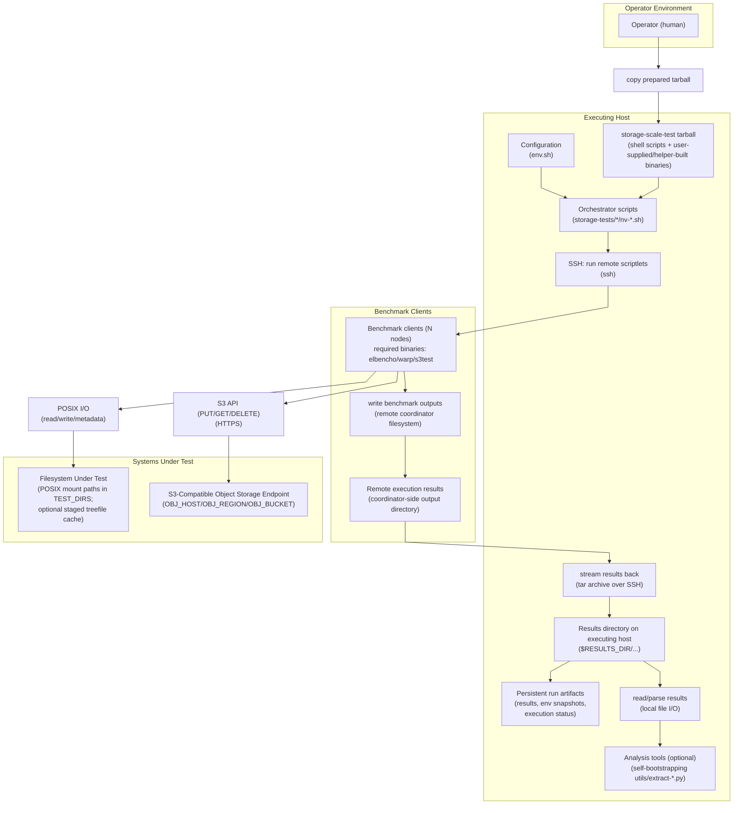
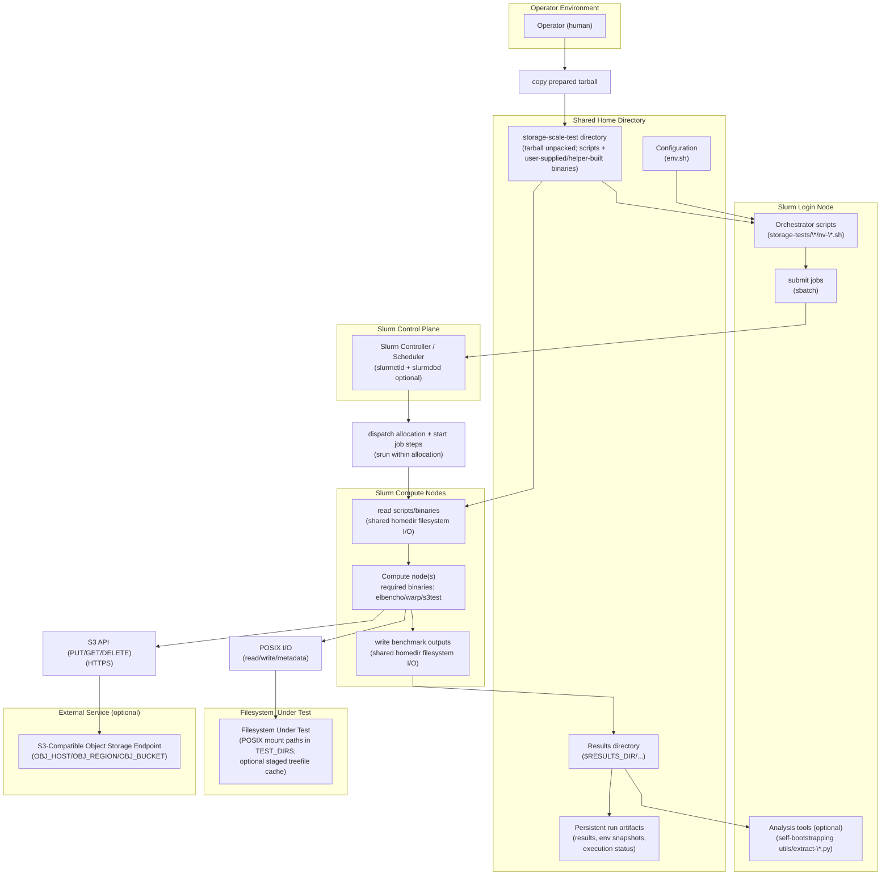
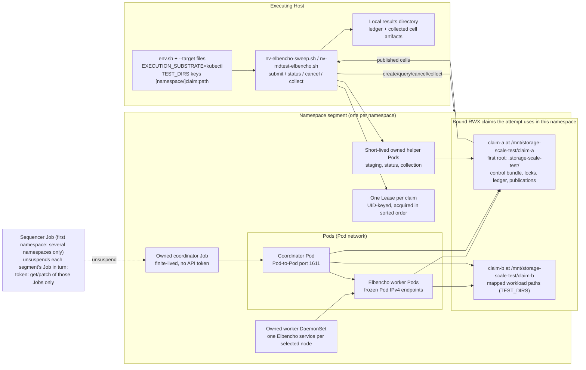

<!--
SPDX-FileCopyrightText: Copyright (c) 2026 NVIDIA CORPORATION & AFFILIATES. All rights reserved.
SPDX-License-Identifier: Apache-2.0

Licensed under the Apache License, Version 2.0 (the "License");
you may not use this file except in compliance with the License.
You may obtain a copy of the License at

http://www.apache.org/licenses/LICENSE-2.0

Unless required by applicable law or agreed to in writing, software
distributed under the License is distributed on an "AS IS" BASIS,
WITHOUT WARRANTIES OR CONDITIONS OF ANY KIND, either express or implied.
See the License for the specific language governing permissions and
limitations under the License.
-->

# NVIDIA Storage Scale Test — Architecture

## Product Architectural Specification

NVIDIA Storage Scale Test is a benchmark orchestration tool packaged by the user as a single tarball for transfer into a test environment. This repository does not distribute pre-built benchmark binaries; users are responsible for obtaining, building, validating, and complying with license/security requirements for the binaries they include. The architecture has four components:

1. **Orchestration layer.** Shell scripts on an executing host (login node or workstation) drive benchmark execution. `env.sh` parameterizes all behavior; filesystem launchers may layer target files and workload override files. The orchestration layer supports three explicitly selected dispatch mechanisms:
   - **Slurm:** Jobs are submitted via `sbatch` to a Slurm controller, which allocates compute nodes and executes benchmark workloads within job allocations.
   - **SSH:** Benchmark code is transmitted as self-contained scriptlets to remote nodes over passwordless SSH. Results are streamed back through SSH, normally as tar archives.
   - **kubectl:** Filesystem sweeps (`nv-elbencho-sweep.sh` and `nv-mdtest-elbencho.sh`) create, in each existing Kubernetes namespace their claims live in, an attempt-scoped worker DaemonSet and coordinator Job that mount every claim the attempt uses in that namespace. The submitter returns after dispatch; later lifecycle commands query status, cancel, or collect the durable attempt.

2. **Benchmark clients.** One or more nodes run required benchmark and connectivity binaries (for example elbencho, Warp, and s3test) that were supplied by the user or produced by helper build scripts before the tarball was taken into the test environment. These nodes issue IO against the systems under test and write result files to local or shared storage.

3. **Systems under test.** The targets of benchmark IO:
   - POSIX filesystems mounted on the benchmark clients.
   - S3-compatible object storage endpoints accessed over HTTPS.
   - Network paths between benchmark clients (TCP throughput/latency).

4. **Analysis tools.** Executable Python tools bootstrap a shared virtual environment, then parse result files and produce terminal tables and PNG plots. Filesystem reports also write a results document and an HTML report; netbench and Warp reports can add Markdown.

The tool has no always-running daemon or server-side control plane. A
Kubernetes filesystem sweep creates a finite-lived coordinator Job per
namespace and worker DaemonSets that persist until `--collect` or `--cancel`.
Coordinator, worker, helper, and validation Pods carry no API token; only the
sequencer Job, used for batches spanning namespaces, mounts a ServiceAccount
token limited to get/patch of that attempt's named coordinator Jobs. The
submitter intentionally persists run artifacts under `RESULTS_DIR`, including
result data, configuration snapshots, and reified filesystem-sweep executions
with their status sentinels. Kubernetes attempts additionally persist their
control bundle, ownership identity, endpoint evidence, execution ledger, and
completed-cell publications under `.storage-scale-test` in each namespace's
control root (the lexically first `TEST_DIRS` root across all groups in that
namespace), on that root's claim. Optional treefile caches are stored alongside
staged datasets. Together these artifacts support report regeneration,
asynchronous collection, dataset reuse, and `--resume` of either filesystem
launcher after an interrupted run.

No component requires an inbound connection from outside the cluster or other
operator-controlled benchmark environment. Within that boundary, benchmark
clients receive SSH connections from the executing host, and elbencho/Warp
benchmark services open temporary listeners for their coordinators and peer
clients.
Outbound connections to configured services such as an S3-compatible endpoint
may cross the cluster boundary. Infrastructure administrators can enforce this
model with network access policies and firewalls that deny outside-initiated
connections while permitting the required internal benchmark traffic and
explicitly configured outbound traffic.

The diagrams below illustrate the three execution substrates and the
filesystem reporting pipeline.

---

## SSH Mode (Passwordless SSH Cluster)



## Slurm Mode (Login Node + Slurm Controller + Compute Nodes)



## Kubernetes Mode (kubectl + Existing RWX Claims)

Kubernetes mode is implemented for the filesystem Elbencho launchers,
`nv-elbencho-sweep.sh` and `nv-mdtest-elbencho.sh`. It requires an already
authorized `kubectl` context, existing namespaces, and Bound RWX claims in
Filesystem volume mode, named by `TEST_DIRS` keys of the form
`[namespace/]claim:path`. The claims must be visible from the selected nodes;
this tool does not provision PVs or claims.

Each namespace an attempt uses is one **segment**. Its Pods mount every claim
the segment uses, one subdirectory per claim, and `claim:path` maps to
`/mnt/storage-scale-test/<claim>/<path>`. With one namespace (the usual case,
even for several targets) there is one segment and no sequencer. With several
namespaces, the segments' coordinator Jobs are created suspended and a
sequencer Job, in the first namespace, starts them one at a time.



The attempt identity (namespace, claim, bound PV, and UIDs per claim), the
ownership nonce, Kubernetes resource UIDs, node selection, and worker endpoint
evidence are persisted locally and on each segment's control root. Each
resource is labeled and annotated for exact ownership. The coordinator
publishes each completed cell before continuing, so a lost Pod or expired
kubectl session does not discard already completed results. Collection verifies
the publication manifest, copies results back to the executing host, removes
attempt state and exact owned resources, and releases the UID-journaled Leases
last, in reverse acquisition order. Details are normative in
[KUBERNETES_ELBENCHO_LIFECYCLE.md](KUBERNETES_ELBENCHO_LIFECYCLE.md).

---

## Filesystem Reporting Pipeline

The filesystem reporters parse raw results once into the results document
([MACHINE_READABLE_RESULTS.md](MACHINE_READABLE_RESULTS.md)) and render every
output from it. Boxes marked "pool" run in the report process pool; the rest
runs in the parent.

```text
 result dir, batch dir,              --from-json results.json ...
 or several dirs                     (one or more documents)
        |                                        |
        v                                        |
 discover executions and live CSVs               |
        |  one task per execution, one per live CSV
        v                                        |
+- pool: parse -------------------------+        |
| .csv/.out  --> phase entries          |        |
| .live.csv  --> live objects, and      |        |
|                results.live/ sidecars |        |
+------------------+--------------------+        |
                   v                             |
 assemble and write results.json                 |
                   |<----------------------------+
                   v
 load documents, apply --only-* filters,
 build report model (pairs sections across documents)
                   |
     +-------------+---------------------+
     v             v                     v
 text tables   report.html     +- pool: plots ------------+
 (stdout,                      | PNGs per plot set and    |
 report.txt)                   | live domain (reads       |
                               | results.live/ sidecars)  |
                               +--------------------------+
```

A batch submits every group's parse tasks before assembling any group, and
writes one `results.json` and one `report.html`. Plot tasks start once the
model exists, so PNGs render while the parent writes text and HTML.
